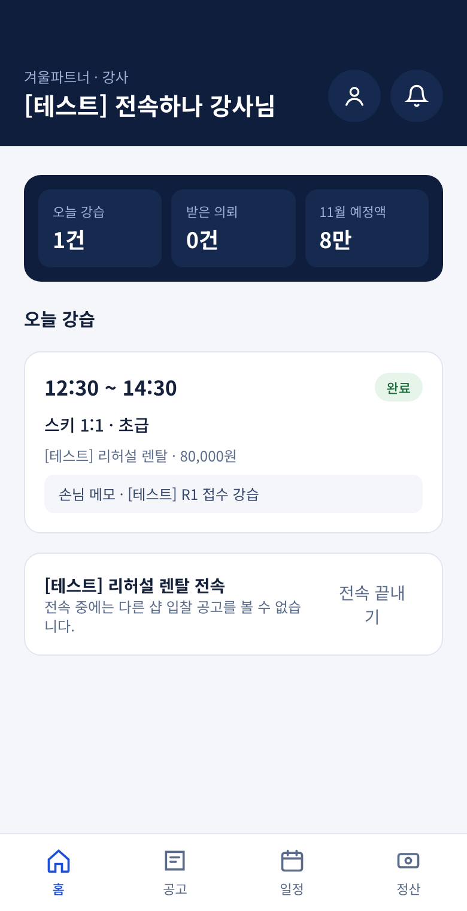
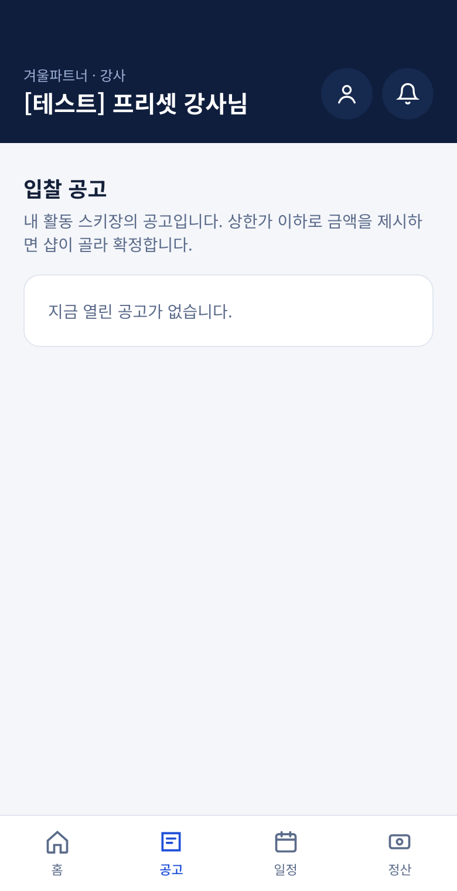
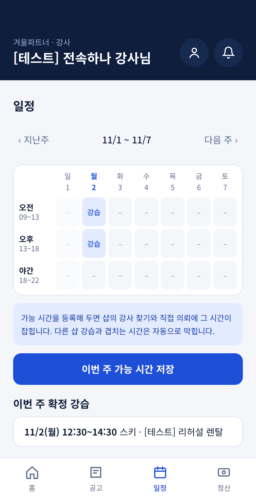
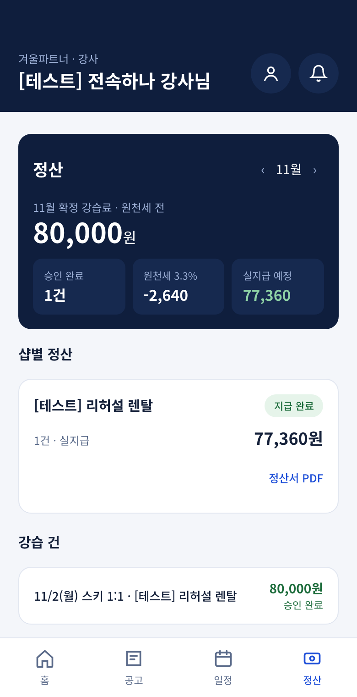

# 겨울파트너 사용 안내 — 강사용

> 앱 안에서는 /help 에서 같은 내용을 볼 수 있습니다. 화면 그림은 [테스트] 데이터입니다.

의뢰를 받거나 공고에 입찰하고, 강습이 끝나면 완료 보고를 하면 월말에 정산이 들어옵니다.

## 1. 받은 의뢰 수락하기

- 홈에 '받은 의뢰'가 뜨면 날짜·장소·금액을 확인합니다.
- '수락' 또는 '거절'을 누릅니다. 수락하면 일정에 들어갑니다.
- 수락한 강습을 취소하면 패널티가 쌓이니 일정이 확실할 때만 수락하세요.

## 2. 공고에 입찰하기

- 아래 '공고' 탭에서 내 활동 스키장·내 종목(스키·스노우보드·스노우스케이트)의 공고를 봅니다.
- 상한 금액 이하로 금액을 적어 입찰합니다.
- 샵이 고르면 '선정' 알림이 옵니다. 전속 강사는 다른 샵 공고가 보이지 않습니다.

## 3. 일정과 가능한 시간

- '일정' 탭에서 확정된 강습을 봅니다.
- 강습 가능한 날과 시간을 넣어 두면 샵이 나를 찾기 쉬워집니다.

## 4. 완료 보고와 수업 메모

- 강습이 끝나면 홈의 '완료 보고'를 누릅니다.
- 다음 강사에게 도움이 될 수업 메모를 남깁니다(손님 건강 이야기는 적지 마세요).
- 샵이 승인하면 정산에 들어갑니다.

## 5. 정산 확인

- '정산' 탭에서 달마다 받을 금액을 봅니다.
- 프리랜서는 3.3%가 빠진 금액이 실지급액입니다.
- 샵이 송금하고 '지급 완료'를 누르면 알림이 옵니다.

**알림 켜기** — 알림 화면에서 '알림 켜기'를 누르면 새 의뢰와 선정 소식을 바로 받습니다.
