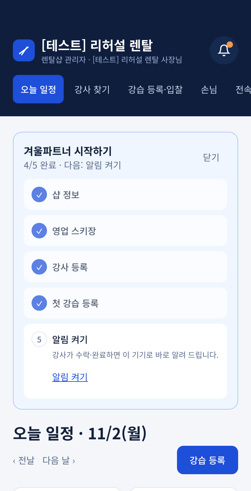
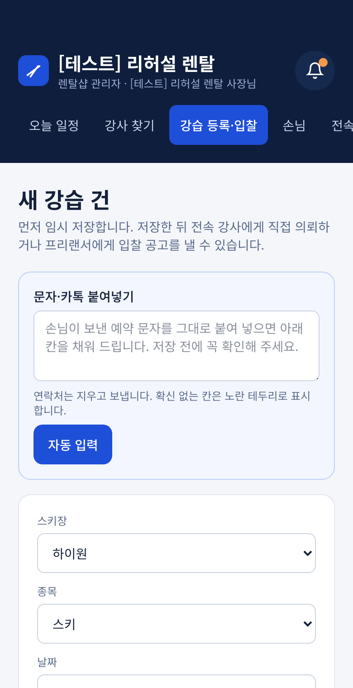
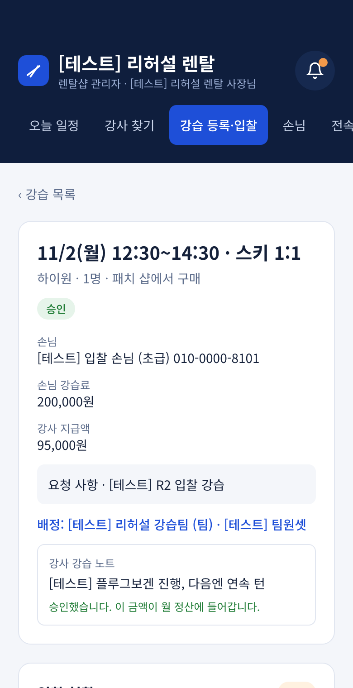
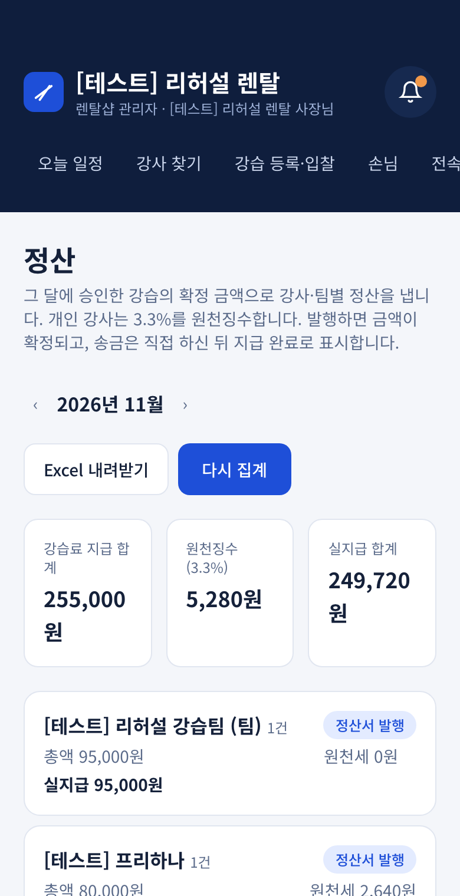
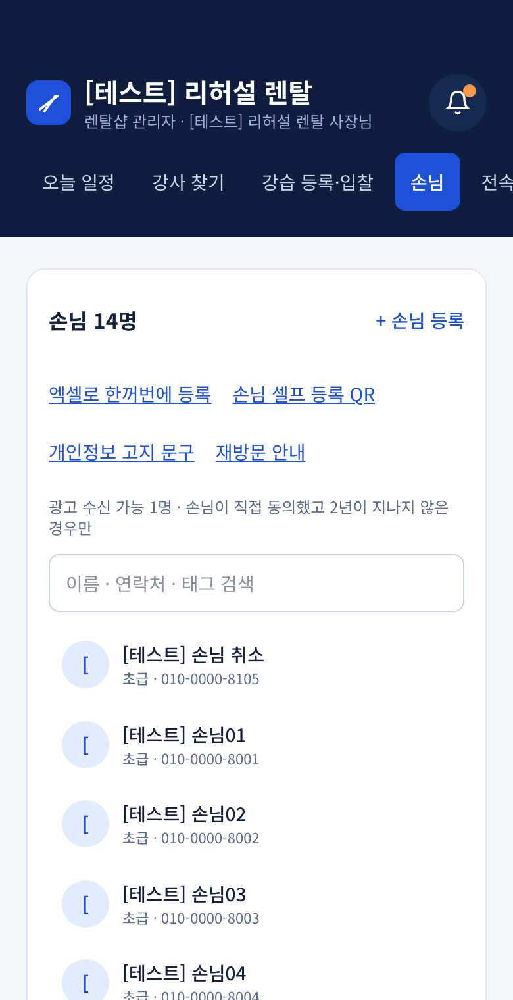

# 겨울파트너 사용 안내 — 샵 사장님용

> 앱 안에서는 /help 에서 같은 내용을 볼 수 있습니다. 화면 그림은 [테스트] 데이터입니다.

강습을 올리고, 강사를 정하고, 끝나면 승인해서 월말에 정산서를 받는 흐름입니다.

## 1. 오늘 일정 보기

- 로그인하면 '오늘 일정'이 먼저 나옵니다.
- 강습 수, 배정된 강사, 확인할 일(취소·미배정·승인 대기)을 한눈에 봅니다.
- '전날·다음 날'로 다른 날을 봅니다.

## 2. 강습 등록하기

- '강습 등록'을 누릅니다.
- 손님 접수 문자를 그대로 붙여 넣으면 날짜·시간·인원 칸이 채워집니다(AI 도우미가 켜져 있을 때). 맞는지 꼭 확인하세요.
- 강사를 바로 정하려면 '직접 의뢰', 여러 강사에게 받으려면 '입찰 공고'를 고릅니다.
- 한 강습은 종목 하나입니다. 부모는 스키, 아이는 스노우보드처럼 섞이면 종목별로 따로 등록하세요.

## 3. 강사 정하기

- 직접 의뢰: 강사가 수락하면 알림이 옵니다. 거절하면 다른 강사에게 다시 보냅니다.
- 입찰 공고: 강습 화면의 '입찰 현황'에서 금액·평점을 보고 '선정'을 누릅니다. 금액은 고칠 수 있습니다.
- 같은 시간에 다른 샵 강습이 있는 강사는 고를 수 없습니다.

## 4. 완료 승인과 월 정산

- 강사가 '완료 보고'를 하면 알림이 옵니다. 강습 화면에서 '승인'을 누릅니다.
- 월말에 '정산'에서 강사별 금액을 확인하고 '발행'합니다. 프리랜서는 3.3%가 빠집니다.
- 전속 강사 지급 방식은 '전속'에서 고릅니다(기본 3.3%). 세무사와 확인하세요.
- 송금은 직접 하고, 보낸 뒤 '지급 완료'를 누릅니다. 정산서는 PDF·엑셀로 받습니다.

## 5. 손님 관리

- '손님'에서 이름·연락처·태그로 찾습니다.
- 엑셀 명단은 '엑셀로 한꺼번에 등록'으로 한 번에 올립니다.
- 광고 문자를 보내려면 손님 카드의 '동의 링크'로 손님에게 직접 동의를 받으세요. 14세 미만은 보호자 동의가 필요합니다.

**알림 켜기** — 알림을 켜 두면 강사의 수락·완료 보고를 바로 받습니다. 알림 화면에서 '알림 켜기'를 누르세요. 아이폰은 사파리에서 '홈 화면에 추가'를 한 뒤 켤 수 있습니다.
